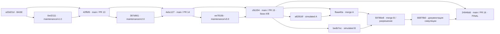

# Lab № 6 — элементы конфигурации и проверенные доказательства

## Состояние и границы работы

Это документационный блок для будущего отчета Word, а не новая итерация
функциональности. Ответственный пользователь репозитория — **@JoanTarazona99**.
Copilot — помощь ИИ при анализе и подготовке материалов, не второй человек.
По сообщению пользователя, преподаватель принимает учебную симуляцию команды;
это не утверждение о наличии письменного согласования.

До работы checkout `lab6/team-sim-integration` имел чистый worktree и HEAD
`66879b0ab34e2bf1d705d3bc806e319446303d1f`. После `git fetch origin`
`origin/main` равен `24946dd8873615ab01a86bde9eed839f0307b98f`.
Это merge PR #16; более поздних commits в main на момент проверки нет.
От этой базы создана ветка `docs/lab6-configuration-evidence`.

| Этап | PR, состояние | Проверенный merge |
|---|---|---|
| Итерация 1 | [#13](https://github.com/JoanTarazona99/student-project-management/pull/13), MERGED | `42ffbf5d453d57d3b05afacad9cd2cc1f57bd350` |
| Итерация 2 | [#14](https://github.com/JoanTarazona99/student-project-management/pull/14), MERGED | `4ebc1277819996a76f5e66e2b2aaa5723eee3e82` |
| Итерация 3 | [#15](https://github.com/JoanTarazona99/student-project-management/pull/15), MERGED | `cfb1f0423e8959a2d232f427f0aa355811947eec` |
| Дополнительная симуляция | [#16](https://github.com/JoanTarazona99/student-project-management/pull/16), MERGED | `24946dd8873615ab01a86bde9eed839f0307b98f` |

Проверены локальные и remote branches через `git branch -a`; сохранены
`maintenance/v1.0`, `maintenance/v2.0`, `maintenance/v3.0`,
`lab6/team-sim-a`, `lab6/team-sim-b`, `lab6/team-sim-integration` и их
`origin/` refs. Также существуют main, lab5-development, test/backend-integration
и предыдущие feature-ветки. Их существование не означает публикацию версии.
`git tag --list` и `git ls-remote --tags origin` вернули пустой результат.
Все три предлагаемых имени свободны на момент проверки.

## Матрица элементов конфигурации

Во всех строках ответственный **@JoanTarazona99**, Copilot — только помощь ИИ.
«Пользователи элемента» ниже — роли потребителей, а не выдуманные участники.
Правила описывают примененный порядок работы и контракты файлов; это не
заявление о настроенных branch protections, обязательном approval или
других непроверенных GitHub-политиках.

| ID, назначение | Реальные файлы / структура | Пользователи элемента | Связь |
|---|---|---|---|
| CM-01 Сервер: API, авторизация, предметные операции | [app/](../../app/): `main.py`, `auth.py`, `security.py`, `database.py`, `users.py`, `projects.py`, `planning.py`, `materials.py`, `reports.py`, `deadlines.py`, `audit.py`, `admin_lock.py`, `web_ui.py` | Сопровождающий; UI и API-клиенты; тесты | CM-02 вызывает API; CM-03 хранит данные; CM-04 задает зависимости; CM-05 проверяет |
| CM-02 Web UI: существующие действия и навигация | [app/ui/](../../app/ui/): `app.js`, `index.html`, `style.css` | Студент, руководитель, преподаватель, сотрудник кафедры, администратор — в пределах реальных permissions; сопровождающий | Ресурсы от CM-01; Chromium CM-05; руководство CM-07 |
| CM-03 БД: схема, начальные данные и проверка | [01_schema_student_projects.sql](../../database/01_schema_student_projects.sql), [02_verify_student_projects.sql](../../database/02_verify_student_projects.sql) | Сопровождающий и fixture тестов | CM-01 SQL; CM-05 создает отдельный сервер; CM-07 объясняет запуск |
| CM-04 Зависимости: прямые, lock и test | [requirements.txt](../../requirements.txt), [requirements.lock.txt](../../requirements.lock.txt), [requirements-test.txt](../../requirements-test.txt) | Сопровождающий; локальный Python; runner CI | Сервер CM-01, проверки CM-05/06 |
| CM-05 Проверки: unit, API/интеграции, Chromium | [scripts/test_materials_unit.py](../../scripts/test_materials_unit.py), [tests/](../../tests/), [conftest.py](../../tests/conftest.py), [pytest.ini](../../pytest.ini) | Сопровождающий; reviewer; CI | Проверяют CM-01/02/03, устанавливаются через CM-04, запускаются CM-06 |
| CM-06 CI: автоматическая проверка | [backend-tests.yml](../../.github/workflows/backend-tests.yml) | Сопровождающий/reviewer; GitHub Actions runner | Устанавливает CM-04, выполняет CM-05, результат привязан к SHA |
| CM-07 Документация техническая и пользовательская | [README.md](../../README.md), [README_web_ui_RU.md](../../README_web_ui_RU.md), [README_tests_RU.md](../../README_tests_RU.md), русские guides материалов, отчетов, deadlines, дат плана, пользователей и ролей | Пользователь существующих функций; сопровождающий; преподаватель | Описывает CM-01–06; не заменяет проверку кода/CI |
| CM-08 Конфигурационные шаблоны и служебные скрипты | [.env.example](../../.env.example), [.gitignore](../../.gitignore), [scripts/](../../scripts/) | Сопровождающий | Только шаблон и код скриптов versioned; реальные настройки и данные исключены |
| CM-09 Доказательства Lab № 6 | [iteration-1.md](iteration-1.md), [iteration-2.md](iteration-2.md), [iteration-3.md](iteration-3.md), [team-simulation.md](team-simulation.md), [version-plan.md](version-plan.md), [evidence/](evidence/) и этот файл | Пользователь, reviewer, преподаватель, автор будущего отчета Word | Ссылаются на реальные CM-02/05/06 и историю Git; не меняют production |

### Правила изменения, имена и применимые проверки

| ID | Правила изменения и именования | Контроль |
|---|---|---|
| CM-01 | Python-модули `snake_case`; изменения в ветке с последующим PR. Не менять API/правила ради зеленых тестов. В этом задании сервер не меняется | Синтаксис Python, соответствующие unit/API/интеграционные тесты; CI |
| CM-02 | Один существующий vanilla-JS UI, русские тексты, безопасный DOM/textContent, внешние CSS, действующая CSP. Сохранять память сессии, поколения запросов, подтверждения и return context | `node --check`; реальные Chromium-сценарии с disposable PostgreSQL; проверки ARIA/клавиатуры не означают WCAG-аудит |
| CM-03 | Сохранить пронумерованные SQL-файлы. Начальный SQL требует `student_projects`, `spm_dev` и пустую пользовательскую схему; имена не доказывают изоляцию | Fixture создает принадлежащий тестам сервер, запускает исходный SQL; никаких destructive команд на рабочей БД |
| CM-04 | Прямые runtime версии закреплены `==`; lock перечисляет runtime зависимости; test-файл включает lock через `-r`, также закрепляет pytest/Playwright. Единого отдельного test lock-файла нет | Согласованность declarations/lock, установка CI из test-файла, `pip check` при изменениях/валидации; в этом задании установки и правки зависимостей нет |
| CM-05 | `test_*.py`, существующие fixtures; `--reverse-order` проверяет независимость от порядка. Сохранять assertions, не скрывать сбои skip/xfail | 14 отдельных unit и pytest API/Chromium. Локальная полная suite в этом документационном задании не запускалась |
| CM-06 | YAML workflow, существующий `Backend tests`; runner `ubuntu-24.04`, Python 3.13, Docker PostgreSQL 17, test-only Chromium. Здесь не изменяется | Реальные logs/status/headSha. Workflow выполняет обычный pytest; обратный порядок не объявляется частью CI |
| CM-07 | `README_*_RU.md`, относительные ссылки, тексты по реальным контрактам. Не превращать исторические результаты в новые | Проверка путей/ссылок и diff; новый результат тестов — только по выполненной команде |
| CM-08 | Только безопасный шаблон, никогда секретные значения; Python-скрипты именованы по операции. Наличие скрипта не означает его запуск | `.gitignore` исключает `.env`, `.venv`, uploads, backups, caches; проверка состава нового commit |
| CM-09 | Имена `iteration-N.md`, `team-simulation.md`, `configuration-management.md`, `version-plan.md`, bounded `.txt`/`.csv` evidence. BASE/FINAL фиксированы; SHA полные | Генератор читает Git; проверка родителей, независимая сверка ранга, повторная генерация, ссылки, `git diff --check` |

Исторически применены ветки `maintenance/vN.0`, учебные `lab6/team-sim-*`
и документационная `docs/lab6-configuration-evidence`. Последние commits имеют
английский императивный subject (например, `Protect unsaved UI drafts on navigation`);
в более ранней истории также есть `feat:`. Единой технически навязанной
Conventional Commits policy не заявляется. Merge subjects содержат номер PR.
ИИ-помощь прозрачно обозначается trailer-ом Copilot; учебные A/B явно
`Lab6 Simulated Developer A/B`, а не реальные люди.

Не являются versioned-элементами: настоящий `.env`, JWT, реальные пароли,
рабочая БД, содержимое uploads, backups, временные кластеры, HTTP-процессы,
браузерные профили и локальная `.venv`. `.env.example` — только шаблон.
Сборки установщика, опубликованные образы приложения или CI artifacts
не обнаружены и не приписываются проекту. Workflow скачивает `postgres:17`;
это не публикация собственного Docker image.

## Граф и интеграции

Первичные данные: [git-graph.txt](evidence/git-graph.txt),
[merge-log.txt](evidence/merge-log.txt),
[simulation-topology.txt](evidence/simulation-topology.txt).
Граф включает все 12 commits интервала и boundary BASE; merge log содержит
6 интеграций с полными родителями. Для 12 commits явно проверены списки родителей.



Это сокращенные подписи реальных SHAs; полные находятся в текстовых evidence.
Ребро означает родительство, не дополнительный commit.
Три итерации идут последовательно. A/B — параллельные учебные вклады от
одного BASE симуляции; они не являются четвертой итерацией.

## Как определен наиболее изменяемый файл

Основной интервал:

```text
BASE  = a33d21d1a80b6ce959e286e993d49da99e6a5d28
FINAL = 24946dd8873615ab01a86bde9eed839f0307b98f
```

BASE исключен, FINAL включен. Новый документационный commit сюда не входит.
Обход `git rev-list --no-merges BASE..FINAL` включает обе ветки симуляции,
не ограничен `--first-parent`. Для каждого commit `diff-tree -r -M --name-status -z`
собирает множество путей: одна пара commit/файл считается ровно один раз.
Новый файл также считается измененным файлом. Основной ранг — **число commits**,
не число вставленных/удаленных строк и не суммарный размер diff.

Результат: **6 non-merge commits**, **14 файлов**, **27 пар commit/файл**.
Победитель без ничьей — **`app/ui/app.js`, 5 commits**:
три итерации и два учебных вклада A/B.
Следующие `README_tests_RU.md` и `README_web_ui_RU.md` имеют по 4.
В [file-change-ranking.csv](evidence/file-change-ranking.csv) есть все файлы,
равные ранги при равных значениях и SHAs каждой пары. При ничьей за максимум
генератор выбирает лексикографически первый путь и публикует всех лидеров;
в основном интервале этот tie-break не потребовался.

Отдельный [iteration-file-change-ranking.csv](evidence/iteration-file-change-ranking.csv)
считает только три итерации, до `cfb1f0423e8959a2d232f427f0aa355811947eec`.
Там 3 non-merge commits и ничья по 3 изменения:
`README_tests_RU.md`, `README_web_ui_RU.md`, `app/ui/app.js`.
Эта ничья не подменяет результат основного интервала с симуляцией.

[most-changed-file-log.txt](evidence/most-changed-file-log.txt) — настоящий log
пяти non-merge commits выбранного файла: полный SHA, автор, ISO-даты,
subject и статистика файла. Частные emails не включены; названия simulated
идентичностей сохранены.
[most-changed-file-with-merges.txt](evidence/most-changed-file-with-merges.txt)
показывает дополнительный `--full-history -m` log.
Там один merge может повторяться по родителям; это не вход для ранжирования.

[rename-inspection.txt](evidence/rename-inspection.txt) подтверждает:
Git `-M` (порог по умолчанию 50%) не выявил renames ни в non-merge commits,
ни в отдельном обходе merge diffs. Истории разных путей не объединялись
предположениями. Генератор при rename учитывает destination и записывает
старый/новый путь; для текущего интервала это правило не меняет счетчики.

### Почему разрешение конфликта не потеряно

Основная статистика исключает все merges, чтобы не повторять интегрируемые
изменения. Но merge `59786e81ccc55b978aaae3bac9b91ccd03c855d7`
содержит собственную объединенную строку. Поэтому отдельно сохранен
[conflict-resolution-log.txt](evidence/conflict-resolution-log.txt):
метаданные/родители, diff относительно каждого родителя и `git show --remerge-diff`.
По первому родителю добавляется правило буквальных символов, по второму —
правило регистра; оба вклада сохранены. Это не седьмой non-merge commit.
Remerge diff — **новая реконструкция Git**, не выдаваемая за исходный
терминальный вывод. Оригинальный ограниченный transcript хранится в
[team-simulation.md](team-simulation.md). Конфликт был подготовлен намеренно.

## Команды и воспроизводимость

Из корня репозитория, Windows PowerShell; генератор требует Git с поддержкой
`--remerge-diff` и Python, без сторонних пакетов:

```powershell
git status --short --branch
git fetch origin
git rev-parse origin/main
git log --oneline 24946dd8873615ab01a86bde9eed839f0307b98f..origin/main
git branch -a
git tag --list
git ls-remote --tags origin
foreach ($n in 13,14,15,16) {
    gh pr view $n --json number,state,mergedAt,mergeCommit,headRefName,headRefOid,url
}
git switch -c docs/lab6-configuration-evidence origin/main
.\.venv\Scripts\python.exe docs\lab6\evidence\generate_evidence.py
git diff --check
```

Эти команды выполнены. Чтение истории началось в параллельной проверке до
окончания fetch и сначала получило `Invalid revision range`: новый FINAL
еще не был загружен. После успешного fetch тот же диапазон прочитан корректно;
данные/refs для обхода не подменялись.
Генератор выполняет только read-only команды Git и пишет конкретные evidence-файлы;
не меняет index, refs, конфигурацию или историю и не подключается к БД.
Нормализует завершающие пробелы строк evidence; блок remerge имеет префикс `| `,
чтобы архивные маркеры не выглядели неразрешенным конфликтом.
В каждом текстовом log записан использованный Git command.
Результат и границы — в [analysis-summary.txt](evidence/analysis-summary.txt).

Исторические команды `gh run list` и отфильтрованные реальные CI logs —
в [historical-ci.txt](evidence/historical-ci.txt). Они подтверждают
259/266/278 pytest для трех итераций и 282 для дополнительной симуляции,
по 14 unit. Это **не новые локальные запуски**.
Связь версии с tested headSha подробно разделена в [version-plan.md](version-plan.md).

### Выполненная проверка самих evidence

- Все 12 списков родителей совпали с явной ожидаемой топологией.
- Независимый обход `git log --full-history --no-merges --format=%H BASE..FINAL -- <путь>`
  совпал с CSV для всех 14 файлов основного интервала; аналогично проверены
  все 11 путей отдельного интервала трех итераций.
- В графе проверены именно узлы: 12 commits интервала плюс boundary BASE.
  Родители boundary BASE показаны как метаданные, но не считаются узлами
  академического интервала. Первая проверка по всем SHA-токенам графа
  ошибочно включила эти внешние parent-ссылки; проверка уточнена до узлов.
  Сам Git-граф и ранги изменять для этого не потребовалось.
- Множество 6 merge SHA совпало с отдельным `git rev-list --merges`.
- Все относительные Markdown-ссылки двух новых guides разрешаются в
  существующие файлы/каталоги.
- Синтаксис генератора проверен через `ast.parse`, без создания pycache.
- Повторная генерация дала те же SHA-256 содержимого всех 10 генерируемых
  `.txt`/`.csv`: результаты побайтно воспроизводимы.
- `git diff --check` выполнен; перед commit дополнительно проверяется
  staged diff, поскольку обычный diff не охватывает новые untracked файлы.

Независимую сверку основного CSV можно повторить PowerShell-командой ниже
(выполнена дополнительно к проверке Python):

```powershell
$interval = 'a33d21d1a80b6ce959e286e993d49da99e6a5d28..24946dd8873615ab01a86bde9eed839f0307b98f'
foreach ($row in Import-Csv docs\lab6\evidence\file-change-ranking.csv) {
    $commits = @(git log --full-history --no-merges --format=%H $interval -- $row.file)
    if ($commits.Count -ne [int]$row.non_merge_commits) {
        throw "Count mismatch: $($row.file)"
    }
}
```

Это новые проверки **доказательств**, не новые unit/API/Chromium результаты.
Полная suite локально не запускалась: изменены только документы и генератор
исторических evidence. Штатный workflow документационного PR может выполнить
ее самостоятельно; его статус/привязка к финальному SHA проверяются отдельно
при публикации PR, без ретроактивного изменения таблиц трех итераций.

## Что использовать в будущем отчете Word

1. Эту матрицу и цель сопровождения; ответственный реальный пользователь,
   ИИ — ассистент, A/B — симуляция одним исполнителем.
2. Предложение исторических annotated tags, пока без публикации.
3. Реальный граф с тремя итерациями, интеграциями и подготовленным конфликтом.
4. Основной CSV, настоящий log победителя и отдельную реконструкцию resolution.
5. Исторические подтверждения CI, отдельно от CI документационного PR.

Сейчас не создаются Word-файл, теги, GitHub releases, deployments или scheduler.
Lab № 6 не объявляется завершенным: предстоят интеграция этих доказательств,
разрешение на создание/публикацию версий и подготовка итогового отчета.
